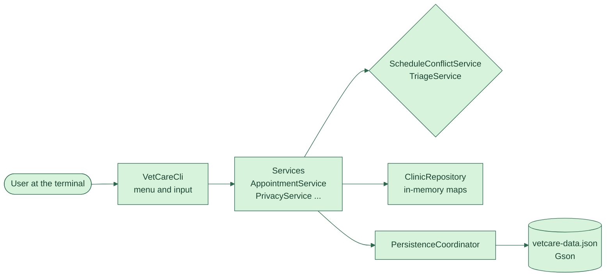

**English** · [Português](README.pt-BR.md)

[](https://github.com/Amandadamata/vetcare-scheduler-java/actions/workflows/ci.yml)


[](LICENSE)

A Java 21 command-line app for booking appointments at a vet clinic.

## The problem

Small veterinary clinics often book two appointments for the same vet at the same time, or leave an urgent case waiting behind a routine check-up. On a busy day nobody has time to check every slot by hand. And when a client asks the clinic to delete their data, deleting it carelessly can leave appointments pointing to an animal that no longer exists.

## The solution

VetCare keeps one schedule per vet or room. Before booking, it checks whether the new time overlaps an existing appointment on that schedule. When the receptionist records the patient's condition and clinical signs, the app works out a triage priority (emergency, urgent or standard) and builds the day's queue in that order. Everything is saved to a local JSON file, so the data is still there the next time the app opens.

## Demo


*Luna can't take Dr. Ana's 10:15 slot because Thor is booked from 10:00 to 10:30. At 10:30 the booking goes through, and because Luna has breathing difficulty she is marked as an emergency. The triage queue then shows her first, even though Thor's appointment starts earlier.*

## Features

- One schedule per vet or room. Two schedules can book the same time, one schedule can't.
- Triage priority calculated from the patient's condition and clinical signs, never picked by hand.
- Daily triage queue and daily summary by status, priority and appointment type.
- Appointment life cycle: scheduled, then completed, no-show or cancelled. Final statuses can't change.
- Delete or anonymize an owner's data without leaving broken references behind.
- JSON storage with safe writes, validation on load and automatic migration of older files (with a backup).

## What this project shows

| Skill | Where / how it shows up |
|---|---|
| Layered architecture | `cli` → `service` → `repository` → `persistence`. `VetCareCli` only talks to services, and `Main` is the one place where concrete classes are created and wired by constructor. Swapping JSON for a database would only touch `persistence`. |
| Business rules | `ScheduleConflictService` rejects an appointment when its interval overlaps another one on the same schedule. Back-to-back slots (10:00–10:30 and 10:30–11:00) are allowed. `TriageService` turns condition and signs into a priority. |
| Collections with a purpose | `AppointmentService` builds the triage queue with a `PriorityQueue` and a `Comparator` (priority, then arrival, then start time). The repository uses `LinkedHashMap`s keyed by `UUID`. |
| OOP and modeling | `AppointmentStatus` is an enum that defines its own allowed transitions. `ClinicDataStore` is an interface, with `JsonClinicDataStore` as the implementation. Five domain exceptions such as `ScheduleConflictException`. |
| Automated tests | 123 JUnit 6 tests in 15 classes, including parameterized tests, a fixed `Clock`, `@TempDir`, a real data file from the previous release and full menu sessions in `VetCareCliTest`. See [docs/TESTING.md](docs/TESTING.md). |
| Data safety | `JsonClinicDataStore` writes to a temporary file and then moves it over the old one, so a crash mid-save can't corrupt the data. `ClinicSnapshotValidator` checks every record on load. |
| Continuous integration | [`ci.yml`](.github/workflows/ci.yml) runs `./mvnw verify` on Java 21 and 25 for every push and pull request. Dependabot keeps dependencies up to date. |
| Documentation | 18 decisions explained in [DESIGN_DECISIONS.md](docs/DESIGN_DECISIONS.md), plus a class-by-class [walkthrough](docs/PROJECT_WALKTHROUGH.md). |

## How it works



You pick an option in the menu and type the details. `VetCareCli` reads and checks the input, then hands it to a service. The service applies the rules: it asks `ScheduleConflictService` whether the slot is free and `TriageService` what the priority is. If everything is valid, the change goes into `ClinicRepository`, which keeps the data in memory, and `PersistenceCoordinator` saves it to the JSON file right away. If saving a deletion fails, the change is also undone in memory.

## Technical decisions

- **I chose a JSON file instead of a database** because I wanted to get layers and validation right first, with no server to install. The `ClinicDataStore` interface keeps that choice contained.
- **I chose to calculate the triage priority instead of letting the user pick it,** because a person in a hurry might choose "standard" for a patient who can't breathe. The rule lives in one place and has its own tests.
- **I chose one generic schedule type for vets and rooms instead of two,** because the current rules never need a vet *and* a room on the same appointment. It's listed as a limitation.
- **I chose to never mark appointments as completed automatically,** because the appointment time passing doesn't mean the patient showed up. Someone at the clinic records it.

## Running it

You need Java 21 or newer. The first build downloads Maven and the dependencies through the Maven Wrapper. I built it in IntelliJ IDEA, but any terminal works.

```bash
git clone https://github.com/Amandadamata/vetcare-scheduler-java.git
cd vetcare-scheduler-java
./mvnw clean package
java -jar target/vetcare-scheduler.jar
```

```bash
./mvnw test
```

On Windows, use `mvnw.cmd`. To keep demo data in another file, set `VETCARE_DATA_FILE=/tmp/vetcare-demo.json` before running. Register a schedule first (option 17). The demo GIF can be recorded again with [VHS](https://github.com/charmbracelet/vhs): `vhs docs/assets/demo.tape`.

## Project structure

```text
src/main/java/com/amandadamata/vetcare/
├── cli/          # menu, prompts and input parsing
├── service/      # scheduling, triage, conflicts, privacy, reports
├── repository/   # in-memory collections
├── persistence/  # JSON load/save, validation, migration
├── model/        # Owner, Animal, Appointment, ScheduleResource and enums
├── exception/    # domain and persistence errors
├── util/         # shared validation rules
└── Main.java     # wires everything together
src/test/         # 123 tests, plus a data file from the previous release
docs/             # architecture, design decisions, testing, walkthrough
```

## Limits and what's next

What it doesn't do yet:

- The triage rules are a simplified example for a software project, not veterinary guidance.
- One process uses the file at a time. There's no login, encryption or network access.
- Deleting data helps a clinic answer a deletion request, but it doesn't make the app LGPD-compliant on its own. Migration backups keep the original data until someone deletes them.

Next steps I'm planning:

- Turn the services into a REST API with Spring Boot, which I'm studying now.
- Replace the JSON file with a SQL database, keeping the same service layer.
- Let one appointment use a vet and a room at the same time.

## Author

**Amanda da Mata** · Back-End developer in training · Java and Python  
[LinkedIn](https://www.linkedin.com/in/amanda-da-mata-492106288) · [amandadamataprofissional@gmail.com](mailto:amandadamataprofissional@gmail.com) · [GitHub](https://github.com/Amandadamata)
