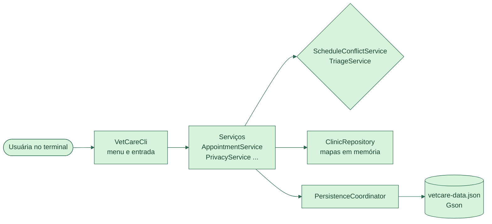

[English](README.md) · **Português**

[](https://github.com/Amandadamata/vetcare-scheduler-java/actions/workflows/ci.yml)


[](LICENSE)

Aplicação de linha de comando em Java 21 para agendar consultas numa clínica veterinária.

## O problema

Em clínicas veterinárias pequenas, é comum marcar duas consultas para o mesmo veterinário no mesmo horário, ou deixar um caso urgente esperando atrás de uma consulta de rotina. Num dia corrido, ninguém tem tempo de conferir cada horário à mão. E quando um cliente pede para a clínica apagar os dados dele, apagar sem cuidado pode deixar consultas apontando para um animal que não existe mais.

## A solução

O VetCare mantém uma agenda para cada veterinário ou sala. Antes de marcar, ele confere se o novo horário se sobrepõe a uma consulta daquela agenda. Quando a recepção registra a condição do paciente e os sinais clínicos, o sistema calcula a prioridade de triagem (emergência, urgente ou padrão) e monta a fila do dia nessa ordem. Tudo fica salvo num arquivo JSON local, então os dados continuam lá na próxima vez que o programa abrir.

## Demonstração


*A Luna não consegue o horário das 10:15 com a Dra. Ana, porque o Thor está marcado das 10:00 às 10:30. Às 10:30 o agendamento passa e, como a Luna tem dificuldade para respirar, ela entra como emergência. A fila de triagem mostra a Luna primeiro, mesmo com a consulta do Thor começando antes. (A interface do programa é em inglês.)*

## Funcionalidades

- Uma agenda por veterinário ou sala. Duas agendas podem ter consulta no mesmo horário; a mesma agenda, não.
- Prioridade de triagem calculada a partir da condição e dos sinais clínicos, nunca escolhida à mão.
- Fila de triagem do dia e resumo diário por status, prioridade e tipo de consulta.
- Ciclo de vida da consulta: agendada, depois realizada, falta ou cancelada. Status finais não mudam mais.
- Exclusão ou anonimização dos dados de um tutor sem deixar referências quebradas.
- Armazenamento em JSON com gravação segura, validação ao carregar e migração automática de arquivos antigos (com backup).

## O que este projeto mostra

| Habilidade | Onde e como aparece |
|---|---|
| Arquitetura em camadas | `cli` → `service` → `repository` → `persistence`. O `VetCareCli` só conversa com os serviços, e o `Main` é o único lugar onde as classes concretas são criadas e ligadas pelo construtor. Trocar o JSON por um banco mexeria só em `persistence`. |
| Regras de negócio | O `ScheduleConflictService` recusa uma consulta quando o intervalo dela se sobrepõe a outra da mesma agenda. Horários colados (10:00–10:30 e 10:30–11:00) são permitidos. O `TriageService` transforma condição e sinais em prioridade. |
| Coleções com propósito | O `AppointmentService` monta a fila de triagem com uma `PriorityQueue` e um `Comparator` (prioridade, depois ordem de chegada, depois horário). O repositório usa `LinkedHashMap`s com chave `UUID`. |
| POO e modelagem | `AppointmentStatus` é um enum que define as próprias transições permitidas. `ClinicDataStore` é uma interface, implementada por `JsonClinicDataStore`. Cinco exceções de domínio, como `ScheduleConflictException`. |
| Testes automatizados | 123 testes JUnit 6 em 15 classes, com testes parametrizados, `Clock` fixo, `@TempDir`, um arquivo de dados real da versão anterior e sessões completas do menu no `VetCareCliTest`. Veja [docs/TESTING.md](docs/TESTING.md). |
| Segurança dos dados | O `JsonClinicDataStore` grava num arquivo temporário e depois o move por cima do antigo, então uma queda no meio da gravação não corrompe os dados. O `ClinicSnapshotValidator` confere cada registro ao carregar. |
| Integração contínua | O [`ci.yml`](.github/workflows/ci.yml) roda `./mvnw verify` no Java 21 e no 25 a cada push e pull request. O Dependabot mantém as dependências atualizadas. |
| Documentação | 18 decisões explicadas em [DESIGN_DECISIONS.md](docs/DESIGN_DECISIONS.md) e um [passo a passo](docs/PROJECT_WALKTHROUGH.md) classe por classe (em inglês). |

## Como funciona



Você escolhe uma opção no menu e digita os dados. O `VetCareCli` lê e confere a entrada e passa para um serviço. O serviço aplica as regras: pergunta ao `ScheduleConflictService` se o horário está livre e ao `TriageService` qual é a prioridade. Se tudo estiver certo, a mudança vai para o `ClinicRepository`, que guarda os dados em memória, e o `PersistenceCoordinator` salva no arquivo JSON na mesma hora. Se a gravação de uma exclusão falhar, a mudança também é desfeita na memória.

## Decisões técnicas

- **Escolhi um arquivo JSON em vez de um banco de dados** porque queria acertar primeiro as camadas e a validação, sem servidor para instalar. A interface `ClinicDataStore` deixa essa escolha isolada.
- **Escolhi calcular a prioridade em vez de deixar a pessoa escolher,** porque alguém com pressa pode marcar "padrão" para um paciente que não consegue respirar. A regra fica num lugar só e tem testes próprios.
- **Escolhi um único tipo de agenda para veterinários e salas,** porque as regras atuais nunca precisam de um veterinário *e* uma sala na mesma consulta. Isso está registrado como limitação.
- **Escolhi nunca marcar uma consulta como realizada automaticamente,** porque o horário da consulta passar não quer dizer que o paciente veio. Alguém da clínica registra.

## Como rodar

Você precisa do Java 21 ou mais novo. O primeiro build baixa o Maven e as dependências pelo Maven Wrapper. Desenvolvi no IntelliJ IDEA, mas qualquer terminal funciona.

```bash
git clone https://github.com/Amandadamata/vetcare-scheduler-java.git
cd vetcare-scheduler-java
./mvnw clean package
java -jar target/vetcare-scheduler.jar
```

```bash
./mvnw test
```

No Windows, use `mvnw.cmd`. Para guardar dados de teste em outro arquivo, defina `VETCARE_DATA_FILE=/tmp/vetcare-demo.json` antes de rodar. Cadastre uma agenda primeiro (opção 17). O GIF da demonstração pode ser gravado de novo com o [VHS](https://github.com/charmbracelet/vhs): `vhs docs/assets/demo.tape`.

## Estrutura do projeto

```text
src/main/java/com/amandadamata/vetcare/
├── cli/          # menu, perguntas e leitura da entrada
├── service/      # agenda, triagem, conflitos, privacidade, relatórios
├── repository/   # coleções em memória
├── persistence/  # leitura e gravação do JSON, validação, migração
├── model/        # Owner, Animal, Appointment, ScheduleResource e enums
├── exception/    # erros de domínio e de persistência
├── util/         # regras de validação compartilhadas
└── Main.java     # liga todas as peças
src/test/         # 123 testes e um arquivo de dados da versão anterior
docs/             # arquitetura, decisões, testes, passo a passo
```

## Limites e próximos passos

O que ainda não faz:

- As regras de triagem são um exemplo simplificado para um projeto de software, não orientação veterinária.
- Um processo por vez usa o arquivo. Não há login, criptografia nem acesso pela rede.
- A exclusão ajuda a clínica a atender um pedido de exclusão, mas sozinha não torna o sistema adequado à LGPD. Os backups de migração guardam os dados originais até alguém apagá-los.

Próximos passos que estou planejando:

- Transformar os serviços numa API REST com Spring Boot, que estou estudando agora.
- Trocar o arquivo JSON por um banco SQL, mantendo a mesma camada de serviços.
- Permitir que uma consulta use um veterinário e uma sala ao mesmo tempo.

## Autora

**Amanda da Mata** · Desenvolvedora Back-End em formação · Java e Python  
[LinkedIn](https://www.linkedin.com/in/amanda-da-mata-492106288) · [amandadamataprofissional@gmail.com](mailto:amandadamataprofissional@gmail.com) · [GitHub](https://github.com/Amandadamata)
