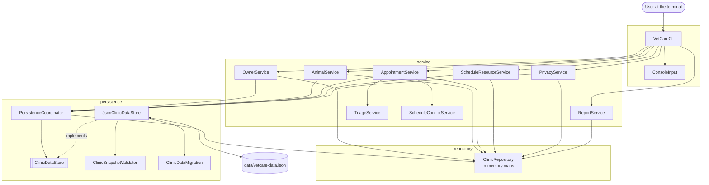
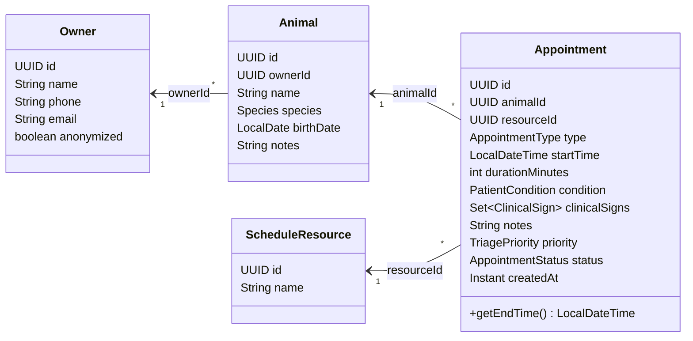
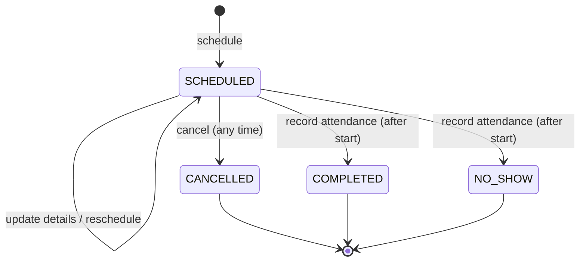
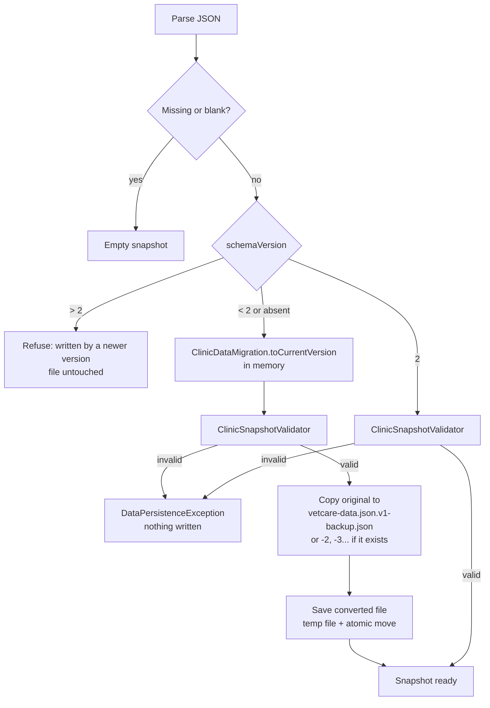
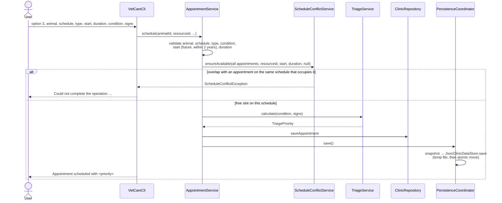
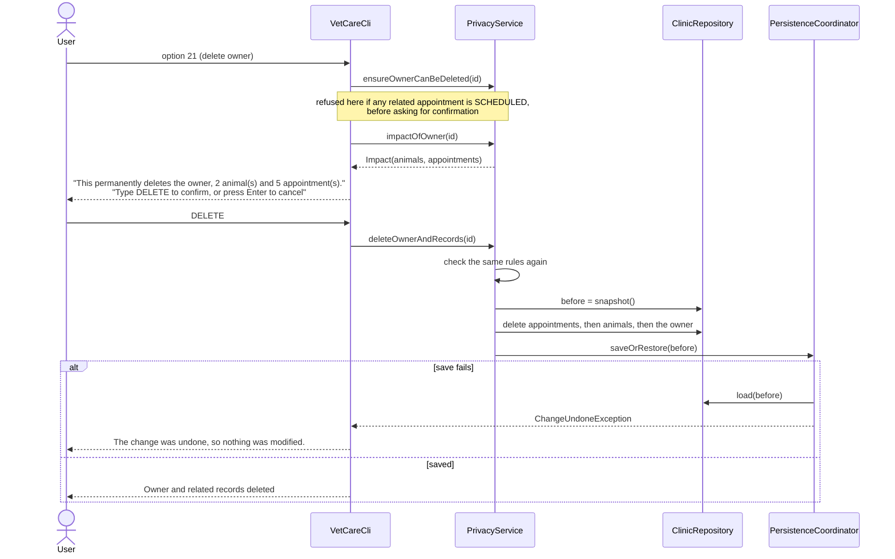

# Architecture

This document shows how VetCare Scheduler is organized and how data moves through it. For the
reasoning behind each choice, see [DESIGN_DECISIONS.md](DESIGN_DECISIONS.md). For a beginner-
friendly tour and interview questions, see [PROJECT_WALKTHROUGH.md](PROJECT_WALKTHROUGH.md).

## Layers

| Package | Responsibility | Depends on |
|---|---|---|
| `cli` | Menu, prompts, parsing typed values, confirmations, printing results | `service`, `model` |
| `service` | Business rules: validation, triage, conflicts, life cycle, schedules, privacy, reports | `repository`, `persistence`, `model`, `util` |
| `repository` | Holds schedules, owners, animals and appointments in `LinkedHashMap`s keyed by `UUID` | `model` |
| `persistence` | Converting the repository to and from JSON, migrating older files, validating loaded data | `repository`, `model`, Gson |
| `model` | Data classes and enums, including the status transition rules | nothing |
| `util` | `Validators`, shared field rules | `exception` |
| `exception` | Domain error types | nothing |

`Main` is the composition root: it is the only place where concrete classes are created and
connected.

## Domain model

Relationships are stored as IDs, not object references. This keeps the JSON flat and makes each
record independently serializable; the services check that referenced IDs exist when data is
created, and `ClinicSnapshotValidator` checks them again when data is loaded.

A `ScheduleResource` is anything that can attend only one appointment at a time: a veterinarian, a
room, an operating table. Each appointment uses exactly one.

## Appointment status

| Status | Occupies the schedule | Final | Meaning |
|---|---|---|---|
| `SCHEDULED` | yes | no | Booked and not yet resolved |
| `COMPLETED` | yes | yes | The patient was attended; the slot was really used |
| `NO_SHOW` | no | yes | The patient did not come; the slot was free |
| `CANCELLED` | no | yes | The booking was withdrawn |

The table lives in the enum (`occupiesSchedule()`, `isFinal()`, `canTransitionTo()`), so the
conflict check, the services and the validator all read the same rules. `AppointmentService` adds
the time rule: attendance can only be recorded once `startTime` is not after "now".

## Startup and file versions

1. `Main` reads `VETCARE_DATA_FILE` (or uses `data/vetcare-data.json`).
2. `PersistenceCoordinator.load()` asks `JsonClinicDataStore` for a `ClinicSnapshot`.
3. `JsonClinicDataStore` parses the JSON with Gson and checks `schemaVersion`:

4. The snapshot is loaded into `ClinicRepository`.
5. If a migration happened, `Main` prints where the backup was written.
6. Services and the CLI are created with the same repository, persistence coordinator and `Clock`.

The migration creates one schedule named `Main schedule` and assigns every existing appointment to
it, which is exactly how version 1 behaved (a single shared schedule). The migration test uses a
file written by the previous release, not one written by hand.

## Scheduling an appointment

Every changing operation follows the same order: **validate → change memory → save the whole
snapshot**. Validation never happens after a change, so a rejected operation leaves memory and
the file as they were.

## Deleting and anonymizing

- Children are removed before their parent, and always together, so no stored record points to a
  missing one.
- Anonymization replaces whole records with copies (`Owner.anonymizedCopy()`,
  `Animal.anonymizedCopy()`, `Appointment.withoutNotes()`) instead of editing fields one by one.
- Deletion and anonymization use `saveOrRestore`: if the file cannot be written, memory goes back
  to the snapshot taken before the change. For personal data, "deleted on screen but still on
  disk" (or the reverse) would be misleading.
- `ScheduleResourceService.delete` uses the same mechanism and refuses schedules that any
  appointment still references.

## Error handling

| Exception | Meaning | Where it is handled |
|---|---|---|
| `ValidationException` | Input breaks a rule (blank name, past date, forbidden status change, scheduled appointments blocking a deletion) | CLI prints it; menu continues |
| `NotFoundException` | An ID does not exist | CLI prints it; menu continues |
| `ScheduleConflictException` | Time slot overlaps an appointment on the same schedule | CLI prints it; menu continues |
| `DataPersistenceException` on load | File unreadable, invalid, from a newer version, or migration not possible | `Main` prints it and does not start |
| `DataPersistenceException` on save (updates) | File could not be written | CLI warns that the change is only in memory and repeats the warning at exit |
| `ChangeUndoneException` (a `DataPersistenceException`) | Save failed during deletion, anonymization or schedule removal; memory was already restored | CLI says the change was undone; no warning at exit, because memory and file agree |
| `ConsoleInput.InputClosedException` | Input stream ended | CLI ends the session |

All domain exceptions are unchecked (`RuntimeException`): they travel from the service layer to
the CLI without every method in between declaring them.

## Saving

`JsonClinicDataStore.save` writes the full snapshot to `vetcare-data.json.tmp`, then moves it over
the real file with `ATOMIC_MOVE` (falling back to a normal replace when the file system does not
support atomic moves). A crash during writing leaves the previous file intact.

## Data that stays outside the main file

| File | When it exists | Contains |
|---|---|---|
| `vetcare-data.json.tmp` | Only if the process stops in the middle of a save | A full snapshot |
| `vetcare-data.json.v1-backup.json` (or `-2`, `-3`...) | After migrating a version 1 file | The original version 1 data |

Deleting or anonymizing a person changes only the main file. These other files are not touched by
the application and must be removed manually if a deletion request has to cover them. In the default
`data/` folder, `.gitignore` excludes all of them (`data/*.json`, `data/*.tmp`).
