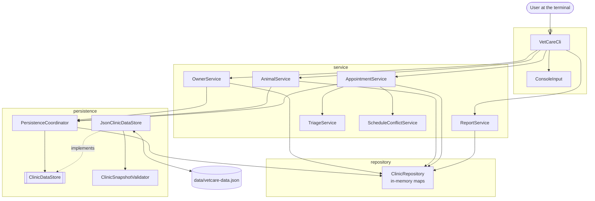
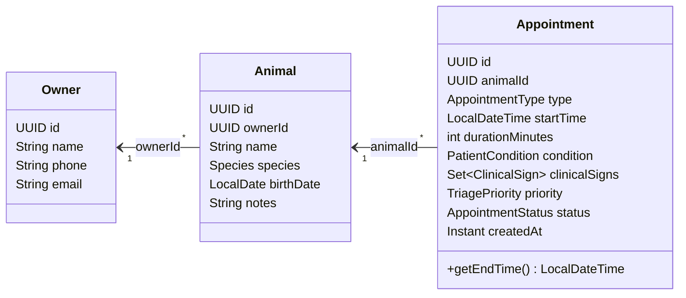
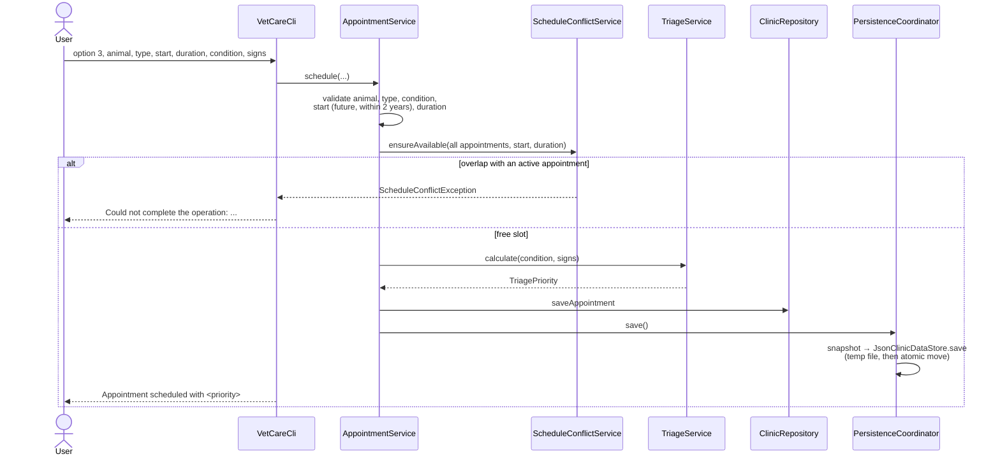

# Architecture

This document shows how VetCare Scheduler is organized and how data moves through it. For the
reasoning behind each choice, see [DESIGN_DECISIONS.md](DESIGN_DECISIONS.md). For a beginner-
friendly tour and interview questions, see [PROJECT_WALKTHROUGH.md](PROJECT_WALKTHROUGH.md).

## Layers

| Package | Responsibility | Depends on |
|---|---|---|
| `cli` | Menu, prompts, parsing typed values, printing results | `service`, `model` |
| `service` | Business rules: validation, triage, conflicts, reports | `repository`, `persistence`, `model`, `util` |
| `repository` | Holds owners, animals and appointments in `LinkedHashMap`s keyed by `UUID` | `model` |
| `persistence` | Converting the repository to and from JSON, validating loaded data | `repository`, `model`, Gson |
| `model` | Data classes and enums | nothing |
| `util` | `Validators`, shared field rules | `exception` |
| `exception` | Domain error types | nothing |

`Main` is the composition root: it is the only place where concrete classes are created and
connected.

## Domain model

Relationships are stored as IDs, not object references. This keeps the JSON flat and makes each
record independently serializable; the services check that referenced IDs exist.

## Startup

1. `Main` reads `VETCARE_DATA_FILE` (or uses `data/vetcare-data.json`).
2. `PersistenceCoordinator.load()` asks `JsonClinicDataStore` for a `ClinicSnapshot`.
3. `JsonClinicDataStore` parses the JSON with Gson, then runs `ClinicSnapshotValidator`.
   - Missing or blank file: empty snapshot.
   - Invalid JSON or impossible data: `DataPersistenceException`; `Main` prints the reason and
     exits without touching the file.
4. The snapshot is loaded into `ClinicRepository`.
5. Services and the CLI are created with the same repository, persistence coordinator and `Clock`.

## Scheduling an appointment

Every changing operation follows the same order: **validate → change memory → save the whole
snapshot**. Validation never happens after a change, so a rejected operation leaves memory and
the file as they were.

## Error handling

| Exception | Meaning | Where it is handled |
|---|---|---|
| `ValidationException` | Input breaks a rule (blank name, past date, duration out of range) | CLI prints it; menu continues |
| `NotFoundException` | An ID does not exist | CLI prints it; menu continues |
| `ScheduleConflictException` | Time slot overlaps an active appointment | CLI prints it; menu continues |
| `DataPersistenceException` on load | File unreadable or invalid | `Main` prints it and does not start |
| `DataPersistenceException` on save | File could not be written | CLI warns that the change is only in memory and repeats the warning at exit |
| `ConsoleInput.InputClosedException` | Input stream ended | CLI ends the session |

All domain exceptions are unchecked (`RuntimeException`): they travel from the service layer to
the CLI without every method in between declaring them.

## Saving

`JsonClinicDataStore.save` writes the full snapshot to `vetcare-data.json.tmp`, then moves it over
the real file with `ATOMIC_MOVE` (falling back to a normal replace when the file system does not
support atomic moves). A crash during writing leaves the previous file intact.
